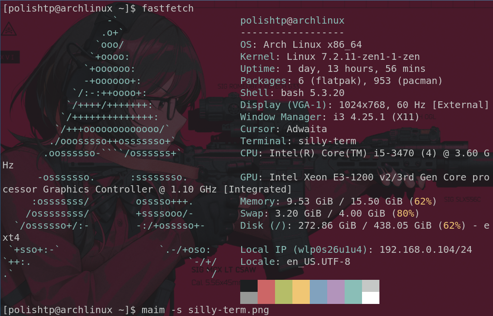
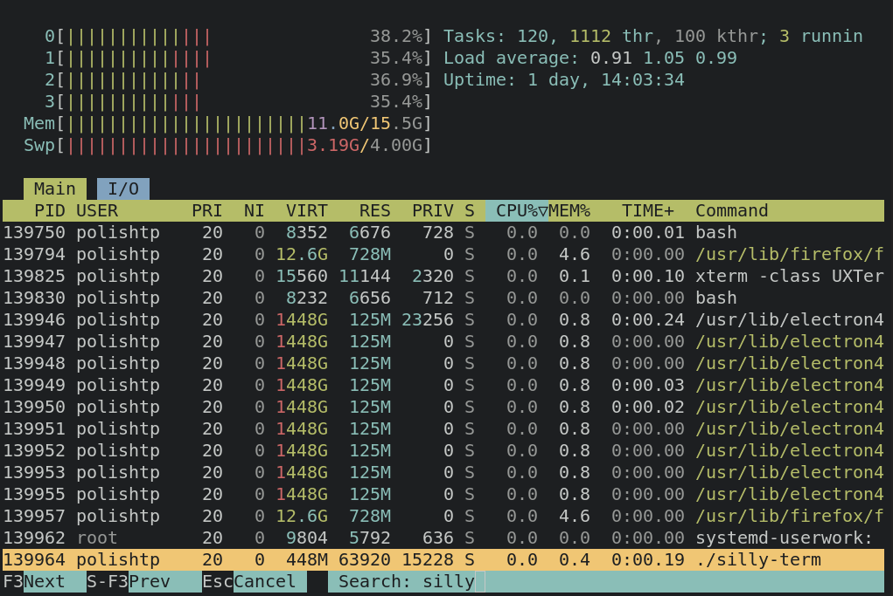

# silly-term

silly-term is a Linux terminal emulator written in C. GLFW creates the window and OpenGL 3.3 context, FreeType rasterizes fonts, libvterm handles terminal behavior, and a pseudoterminal (PTY) connects the emulator to a shell or command.

## Screenshots

<p align="center">
	
	
</p>

## Features

- Truecolor and indexed-color terminal output
- Bounded scrollback, mouse selection, clipboard copy/paste, and optional copy-on-select
- Alternate-screen applications such as `vim`, `less`, and `htop`
- Configurable font, colors, cursor, 16-color palette, shortcuts, and window behavior
- Resizable terminal grid, fullscreen toggle, and keyboard font sizing
- Optional background images, transparency, and undecorated windows
- Mouse reporting for applications that request it; hold Shift to select text instead
- Event-driven rendering and PTY notifications, with no busy polling while idle

## Requirements

- Linux, a C compiler, GNU Make, and `pkg-config`
- GLFW 3, FreeType 2, and libvterm development files
- OpenGL core headers (the OpenGL entry points are loaded through GLFW)
- A monospace font; common DejaVu, Liberation, and Noto font paths are tried automatically

On Debian/Ubuntu, the build dependencies and a default font can be installed with:

```sh
sudo apt install build-essential pkg-config libglfw3-dev libfreetype-dev libvterm-dev libgl-dev fonts-dejavu-core fontconfig
```

## Build and run

```sh
make
./silly-term
```

The Makefile builds objects and the executable under `build/<mode>/`; `./silly-term` is a symlink to the selected build. Available modes are `release` (default), `debug`, and `asan`:

```sh
make MODE=debug
make MODE=asan
```

Use a specific configuration file with `-c`:

```sh
./silly-term -c /path/to/sillyconf.conf
```

Without `-c`, silly-term reads `$XDG_CONFIG_HOME/silly-term/sillyconf.conf`, or `$HOME/.config/silly-term/sillyconf.conf` when `XDG_CONFIG_HOME` is unset. If the file is unavailable, built-in defaults are used. `make install-conf` installs the sample configuration without overwriting an existing file.

The shell is started directly on a PTY. Its configured command is split on spaces and tabs; quoting, shell expansion, and pipelines are not interpreted. `Esc` is sent to the shell, not used to close the window. Close the window with your window manager or exit the shell normally, for example with `Ctrl+D`.

## Default controls

| Action | Shortcut |
| --- | --- |
| Copy selection | `Ctrl+Shift+C` |
| Paste clipboard | `Ctrl+Shift+V` or `Shift+Insert` |
| Select all | `Ctrl+Shift+A` |
| Scroll up/down | `Shift+PageUp` / `Shift+PageDown` |
| Scroll to top/bottom | `Shift+Home` / `Shift+End` |
| Clear scrollback | `Ctrl+Shift+K` |
| Increase font | `Ctrl+=`, `Ctrl+Shift+=`, or `Ctrl+KP_Add` |
| Decrease font | `Ctrl+-` or `Ctrl+KP_Subtract` |
| Reset font | `Ctrl+0` or `Ctrl+KP_0` |
| Toggle fullscreen | `F11` |
| Select text | Left mouse button and drag |
| Paste clipboard | Middle mouse button |
| Scroll | Mouse wheel |

In alternate-screen applications, the wheel sends up/down keys to the application. When mouse reporting is enabled and an application has requested it, mouse events are forwarded to that application unless Shift is held.

## Configuration

The sample [`sillyconf.conf`](sillyconf.conf) documents every setting and its default. Configuration is one `key = value` pair per line; blank lines and lines beginning with `#` or `;` are ignored. Booleans accept `true`/`false`, `yes`/`no`, `on`/`off`, and `1`/`0`. Colors accept three- or six-digit RGB hex values. Numeric values are clamped to supported ranges.

The complete option reference, runtime flow, module responsibilities, and build details are in the [source and runtime guide](docs/silly-guide.md).

## Architecture

The code is organized under `src/`: `main.c` coordinates the event loop; `window.c` manages GLFW and resizing; `input.c` and `keybind.c` handle input and shortcuts; `term.c` and `pty_io.c` connect libvterm to the child process; `pty_watch.c` wakes the event loop when PTY data arrives; and `render.c`, `glyph.c`, and `image.c` implement drawing, font caching, and background images. Public interfaces are in `src/headers/`.

## Scope

silly-term targets Linux. It supports the alternate screen but does not currently implement tabs, splits, ligatures, shell integration, or inline terminal image protocols. Background images are drawn behind the terminal grid; they are not terminal escape-sequence graphics. Clipboard behavior depends on the GLFW windowing backend and desktop session.