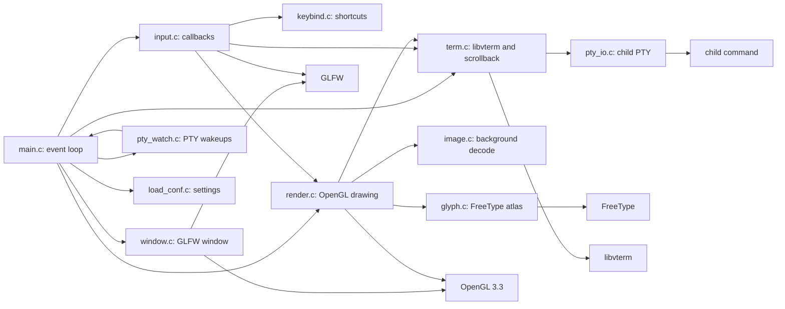

# silly-term: Source and Runtime Guide

This guide describes the current implementation in `src/` and its public interfaces in `src/headers/`. silly-term is a Linux terminal emulator written in C. GLFW owns the window and OpenGL 3.3 context; OpenGL draws the cached terminal grid; FreeType rasterizes glyphs; libvterm parses terminal input and maintains screen state; and a PTY connects libvterm to a child process.

## Runtime map



The diagram shows the main ownership and runtime dependencies. GLFW callbacks update application state and mark the screen for redraw; the PTY watcher uses a worker thread to wake the GLFW event loop when the child has output.

## Source modules

| Files | Responsibility |
| --- | --- |
| `main.c`, `headers/app.h` | Compose configuration, window, view, terminal, and input. Run the event loop, apply window actions, pump PTY output, and shut down resources. `App` is shared with GLFW callbacks through the window user pointer. |
| `window.c`, `headers/window.h` | Initialize GLFW, create a hidden OpenGL 3.3 window, register resize/focus/refresh callbacks, manage fullscreen, and keep the window and terminal grid sized together. |
| `gl.c`, `headers/gl.h` | Load the OpenGL entry points through `glfwGetProcAddress`; the application does not link directly against GL or use GLAD/GLEW. |
| `load_conf.c`, `headers/load_conf.h` | Define `Config`, built-in defaults, config path selection, and the `key = value` parser. |
| `input.c`, `headers/input.h` | Register GLFW keyboard, character, cursor, mouse-button, and scroll callbacks. Route keys to libvterm, run configured actions, manage selection/paste, and forward negotiated mouse events. |
| `keybind.c`, `headers/keybind.h` | Parse shortcut specifications into GLFW key/modifier combinations and match configured alternatives. |
| `term.c`, `headers/term.h` | Own libvterm state, screen, terminal properties, damage tracking, and bounded scrollback. Expose cells to the renderer and pump data from the PTY. This module has no GUI dependency. |
| `pty_io.c`, `headers/pty_io.h` | Spawn the child with `forkpty`, configure its environment and initial size, write to the PTY, and resize it with `TIOCSWINSZ`. |
| `pty_watch.c`, `headers/pty_watch.h` | Block a helper thread in `poll()` for PTY readiness. Wake the main thread once per pending read, then wait for the main thread to acknowledge that it drained the PTY. |
| `render.c`, `headers/render.h` | Manage OpenGL resources, terminal colors, background image placement, row caches, and batched drawing of the grid and cursor. |
| `glyph.c`, `headers/glyph.h` | Use FreeType to rasterize glyphs lazily into a CPU-side atlas, then expose dirty atlas rows for upload by the renderer. Missing glyphs can fall back to another installed font. |
| `image.c`, `headers/image.h`, `headers/stb_image.h` | Decode supported background images to RGBA pixels with the bundled stb_image decoder. `~/` is expanded using `$HOME`. |
| `selection.c`, `headers/selection.h` | Track a linear selected cell range, test cell membership, and export selected terminal text. |
| `util.c`, `headers/util.h` | Encode a Unicode code point as UTF-8 for selection export. |

## Event loop and data flow

1. **Startup:** `main` parses `-c` (or `-h`), loads defaults/configuration, initializes GLFW and the hidden window, creates the renderer, and shows the window at the configured grid size. It then initializes libvterm and starts the configured command on a PTY, installs input callbacks, and starts the PTY watcher thread.
2. **Window and input events:** GLFW callbacks update input, focus, framebuffer, or window state and request a redraw when needed. Resize handling recalculates the number of terminal cells from framebuffer dimensions, padding, and font cell metrics, then updates libvterm and the PTY size.
3. **PTY readiness:** the watcher blocks in `poll()` without busy polling. When the PTY becomes readable or closes, it posts an empty GLFW event and waits until the main thread acknowledges the read. The main loop calls `term_pump`, which feeds available bytes to libvterm and flushes screen damage. Each call processes at most 512 KiB so a large output burst cannot monopolize one loop iteration.
4. **Drawing and sleep:** frames are drawn only when requested and allowed by the configured FPS cap. The renderer rebuilds damaged rows and draws the cached grid, selection, cursor, and optional background image. The loop then waits for a GLFW event or a timeout for a scheduled frame/cursor blink. When neither is pending, it waits indefinitely.
5. **Shutdown:** the watcher is stopped and joined before terminal teardown closes the PTY. The terminal cleanup releases scrollback and libvterm state and reaps the child; the view and GLFW window are then released.

`SIGPIPE` is ignored so a shell closing while a write is in progress does not terminate the emulator process. `term_pump` returns positive when data was processed, zero when idle, and negative when the shell/PTY has exited or failed.

## Configuration

The default path is `$XDG_CONFIG_HOME/silly-term/sillyconf.conf` when `XDG_CONFIG_HOME` is nonempty; otherwise it is `$HOME/.config/silly-term/sillyconf.conf`. If neither environment variable provides a path, built-in defaults remain active. `-c path` selects an explicit config. A missing explicit file prints a warning and uses defaults; a missing implicit file is silent. `-h` prints usage.

Each setting is a `key = value` line. Blank lines and lines beginning with `#` or `;` are ignored. Matching single or double quotes around a value are removed. A `#` starts an inline comment only when preceded by whitespace, so hex colors remain intact. Booleans are case-insensitive `true/yes/on/1` or `false/no/off/0`; colors accept `#rgb`, `rgb`, `#rrggbb`, or `rrggbb`. Numeric values are clamped to their accepted ranges. Unknown keys and malformed values are reported with the file path and line number, and parsing continues.

| Keys | Built-in defaults | Accepted values |
| --- | --- | --- |
| `font_path` | empty | Font path; empty tries common system locations and then `fc-match` when available. |
| `font_size`, `line_height`, `letter_spacing`, `font_smooth`, `font_step` | `20`, `1.2`, `0`, `true`, `2` | `6..200`, `0.5..3.0`, `-10..50`, boolean, `1..20`. |
| `title`, `cols`, `rows`, `padding`, `decorated`, `resizable`, `opacity`, `fps` | `silly-term`, `80`, `24`, `4`, `true`, `true`, `1.0`, `30` | `2..1000`, `1..1000`, `0..200`, boolean, boolean, `0.0..1.0`, `5..360`. `opacity` affects the background only and needs a compositor for transparency. |
| `bg_image`, `bg_image_mode`, `bg_image_opacity` | empty, `cover`, `1.0` | PNG/JPEG/BMP/GIF/TGA path (or empty); `cover`, `contain`, `stretch`, `center`, `tile`; `0.0..1.0`. `~/` expands to `$HOME`. |
| `shell`, `term` | `$SHELL` or `/bin/bash`, `xterm-256color` | Strings. The shell command is split on spaces/tabs, not interpreted by a shell. |
| `scrollback`, `scroll_lines` | `10000`, `3` | `0..1000000`, `1..100`. |
| `cursor_style`, `cursor_blink`, `cursor_blink_ms`, `cursor_blink_timeout`, `cursor_thickness` | `block`, `true`, `600`, `15`, `2` | `block`, `underline`, or `bar`; boolean; `100..5000` ms; `0..3600` seconds (`0` means no timeout); `1..20` pixels. |
| `bold_bright`, `fake_bold`, `copy_on_select`, `mouse_reporting` | `true`, `false`, `false`, `true` | Boolean. |
| `fg`, `bg`, `cursor_color`, `selection_fg`, `selection_bg` | `#c5c8c6`, `#1d1f21`, `#c5c8c6`, `#ffffff`, `#373b41` | 3- or 6-digit RGB hex. |
| `color0` through `color15` | See `sillyconf.conf` | 3- or 6-digit RGB hex. |
| `key_copy`, `key_paste`, `key_select_all`, `key_scroll_up`, `key_scroll_down`, `key_scroll_top`, `key_scroll_bottom`, `key_clear_scrollback`, `key_font_increase`, `key_font_decrease`, `key_font_reset`, `key_fullscreen` | See defaults below | One or more comma-separated key combinations; up to four alternatives per action. |

Default shortcut bindings:

| Setting | Default |
| --- | --- |
| `key_copy` | `ctrl+shift+c` |
| `key_paste` | `ctrl+shift+v, shift+insert` |
| `key_select_all` | `ctrl+shift+a` |
| `key_scroll_up`, `key_scroll_down` | `shift+pageup`, `shift+pagedown` |
| `key_scroll_top`, `key_scroll_bottom` | `shift+home`, `shift+end` |
| `key_clear_scrollback` | `ctrl+shift+k` |
| `key_font_increase` | `ctrl+equal, ctrl+shift+equal, ctrl+kp_add` |
| `key_font_decrease` | `ctrl+minus, ctrl+kp_subtract` |
| `key_font_reset` | `ctrl+0, ctrl+kp_0` |
| `key_fullscreen` | `f11` |

Shortcut modifiers are `ctrl`/`control`, `shift`, and `alt`. Keys include letters, digits, `f1` through `f12`, navigation keys, `space`, `enter`, `tab`, `backspace`, punctuation names (`equal`, `plus`, `minus`, `comma`, `period`, `slash`), and `kp_add`, `kp_subtract`, `kp_0`. A match requires the exact modifier set; key-repeat events also match.

### Terminal and child process

`pty_spawn` sets `TERM` from configuration and `COLORTERM=truecolor`. It splits the configured command on spaces and tabs into at most 31 arguments; quotes, variable expansion, and shell operators have no special meaning. An empty command starts `/bin/sh`. The PTY master is nonblocking, and its size follows the terminal grid.

The terminal core enables libvterm's alternate screen, tracks cursor visibility/title/mouse mode, and stores pushed history lines in a bounded ring. Scrolling is disabled on the alternate screen and clamped to available history. Clearing history releases the saved rows. When a child negotiates mouse reporting and `mouse_reporting` is enabled, pointer events are encoded by libvterm and forwarded to it; holding Shift bypasses reporting for local text selection. On the alternate screen, local wheel input sends up/down keys rather than scrolling emulator history.

### Rendering, fonts, and images

FreeType loads `font_path` first when configured. Otherwise the glyph loader checks common DejaVu, Liberation, and Noto paths and asks `fc-match` for a monospace font as a fallback. Additional installed fonts may be opened lazily when the selected face lacks a glyph. Glyphs are rasterized on demand into a texture atlas; `font_smooth=false` requests one-bit rendering.

The renderer caches row geometry and redraws damaged rows. The configured 16-color palette supplies indices 0-15; extended indexed colors are handled through libvterm. `bold_bright` maps bold foreground indices 0-7 to 8-15, `fake_bold` offsets a second glyph, and reverse video swaps foreground/background. Background images use the configured fit mode; image opacity is multiplied by window opacity. Terminal cell colors remain opaque. The cursor is hidden while viewing scrollback and blinks only while focused, visible, and at the live bottom; after `cursor_blink_timeout` seconds without input it stops toggling.

Supported background image formats are PNG, JPEG, BMP, GIF, and TGA. An empty or unreadable image path leaves the configured solid background in use. These are window backgrounds, not inline terminal graphics protocols.

## Build

The lowercase `makefile` compiles `src/*.c` into `build/<mode>/` and makes the root `silly-term` path a symlink to the selected binary.

```sh
make                         # release build
make MODE=debug              # debug symbols, no optimization
make MODE=asan               # AddressSanitizer build
make run ARGS="-c /path/to/sillyconf.conf"
make install-conf            # install sample config if absent
make clean
```

The compiler defaults to `cc`; compilation uses GNU C11, `-Wall -Wextra`, and pthread support. `pkg-config` is queried for `glfw3`, `freetype2`, and `vterm`; if that query yields no libraries, the Makefile falls back to `-lglfw -lfreetype -lvterm` and the FreeType include directory `/usr/include/freetype2`. Linking also uses `-lutil`, `-lm`, and `-lpthread`. OpenGL functions are resolved through GLFW, so the Makefile does not link directly against `libGL`. The project is Linux-specific because it uses `forkpty`, `pty.h`, and `TIOCSWINSZ`.

## Scope and extension points

The project does not currently implement tabs, splits, ligatures, shell integration, or inline terminal image protocols. Terminal parsing and screen semantics belong in `term.c`/`term.h`; PTY process and descriptor operations belong in `pty_io.c`/`pty_io.h`; input actions and callback routing belong in `input.c`; shortcut syntax belongs in `keybind.c`; window lifecycle belongs in `window.c`; rendering and glyph cache interactions belong in `render.c` and `glyph.c`; configuration fields require coordinated changes to `Config`, `set_defaults`, the option table, and this reference.