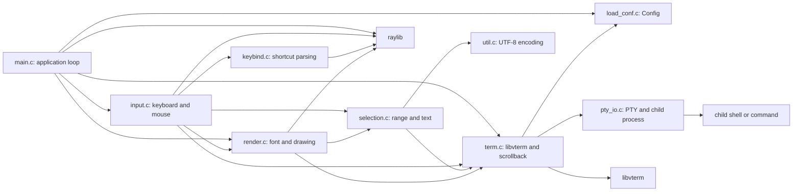

# silly-term: Source and Dependency Guide

This document describes the implementation under `src/` and its public interfaces under `src/headers/`. silly-term is a Linux terminal emulator written in C. raylib supplies the window, input, drawing, and clipboard APIs; libvterm parses terminal control sequences and maintains the terminal screen; a pseudoterminal (PTY) connects that screen to a child shell.

## Runtime at a glance



The arrows show source-level dependencies and external runtime libraries, not a strict layering rule. For example, `input.h` includes `render.h` for the `View` type used by mouse coordinate conversion.

## Source modules and public interfaces

The headers in `src/headers/` declare the interfaces; implementations are in the matching `.c` files. The following table covers every source and header module.

| Module | Public types and functions | Responsibility and dependencies |
| --- | --- | --- |
| `main.c` | `main`; private `load_config`, `open_window`, and title callback | Application composition. Parses `-c`, selects defaults/config, initializes raylib, `View`, `Term`, and `Input`, then handles resize, input, PTY output, and drawing each frame. Uses raylib and the input, config, render, and terminal APIs. Ignores `SIGPIPE` so a closed shell does not terminate the process during a write. |
| `load_conf.h` / `load_conf.c` | `Rgb`, `Config`; `set_defaults`, `default_conf_path`, `load_conf` | Configuration schema, defaults, config path selection, and line-oriented parser. Uses C library routines only; it has no raylib or libvterm dependency. |
| `term.h` / `term.c` | `SbLine`, `Term`; `term_init`, `term_free`, `term_pump`, `term_write`, `term_resize`, `term_scroll`, `term_get_cell` | Terminal core. Owns libvterm objects, PTY master/child identifiers, current dimensions, cursor/alternate-screen state, title, and the scrollback ring. Depends on libvterm, `Config`, and `pty_io`; it has no raylib dependency. |
| `pty_io.h` / `pty_io.c` | `pty_spawn`, `pty_write_all`, `pty_set_size` | Linux PTY process and byte I/O. Starts the command with `forkpty`, makes the parent master descriptor nonblocking, writes with retry handling, and sends grid dimensions using `TIOCSWINSZ`. Depends on Linux/POSIX interfaces including `pty.h`, `poll`, and `ioctl`; the executable links `libutil`. |
| `input.h` / `input.c` | `Input`; `input_init`, `input_keyboard`, `input_mouse` | Converts raylib keyboard/mouse events into libvterm key events or bytes written to the shell. Runs configured copy/paste/scroll bindings, clipboard operations, selection dragging, wheel scrolling, and cursor-blink activity tracking. Depends on raylib, keybind, config, render's `View`, selection, and terminal APIs. |
| `keybind.h` / `keybind.c` | `Bind`; `parse_bind`, `bind_hit`, `key_pressed` | Parses a shortcut string into a raylib key and modifier flags, then detects a press or repeat with an exact modifier match. Depends on raylib for key identifiers and event state. |
| `selection.h` / `selection.c` | `Selection`; `sel_contains`, `sel_text` | Represents a linear, inclusive range in viewport row/column coordinates. Tests cell membership and exports selected cells as allocated UTF-8 text. Depends on `Term` for visible cells and `util` for encoding; no GUI API is used. |
| `render.h` / `render.c` | `View`; `view_init`, `view_free`, `view_pixel_width`, `view_pixel_height`, `render_frame` | Loads a font, computes cell metrics and cursor style, resolves terminal colors, and draws the background, cells, selection, and cursor. Uses raylib, configuration, terminal cells/state, and selection membership. |
| `util.h` / `util.c` | `utf8_encode` | Encodes one Unicode code point into one to four UTF-8 bytes. Used by selection text extraction; no external library dependency. |

## Main loop and data flow

1. **Startup:** `main` ignores `SIGPIPE`, accepts `-c path`, loads configuration, creates a hidden raylib window, initializes font metrics, and sets the initial window dimensions from configured columns and rows. `term_init` then creates libvterm state and starts the configured child command on a PTY.
2. **Resize:** if resizing is enabled and raylib reports a changed window size, `main` derives columns and rows from the pixel dimensions, padding, and `View.cw`/`View.ch`. It clamps each dimension to at least one, calls `term_resize`, and clears the active selection.
3. **Keyboard input:** `input_keyboard` checks configured shortcuts first. Printable characters are drained from raylib's character queue and passed to libvterm; special keys use libvterm key events; Ctrl-letter and selected Ctrl-punctuation combinations are sent as control bytes. Input sent to the shell clears the selection and returns scrollback to the live bottom.
4. **Mouse input:** `input_mouse` maps pointer pixels to a clamped grid coordinate. Left-drag selects, middle-click pastes, and the wheel either changes the scrollback offset or sends up/down keys while the alternate screen is active.
5. **Shell output:** `term_pump` reads available bytes from the nonblocking PTY master and feeds them to `vterm_input_write`. libvterm updates its screen and invokes callbacks for pushed scrollback lines, terminal properties, and output that must be written back to the PTY.
6. **Drawing:** `render_frame` clears the window and obtains every visible cell through `term_get_cell`. It draws cell backgrounds and characters, applies reverse/bold/underline/strike attributes, overlays selection, and renders the cursor according to visibility, focus, blink, and configured style.
7. **Shutdown:** `main` frees the terminal and font resources, then closes the raylib window. `term_free` closes the PTY, signals the child with `SIGHUP`, releases scrollback allocations, and frees libvterm.

## Module contracts and behavior

### Configuration

`Config` is initialized from defaults by both `set_defaults` and `load_conf`. `default_conf_path` chooses `$XDG_CONFIG_HOME/silly-term/sillyconf.conf` when `XDG_CONFIG_HOME` is nonempty; otherwise it uses `$HOME/.config/silly-term/sillyconf.conf`. If neither environment variable is usable, no default path is available. `main` only warns when an explicitly supplied `-c` file cannot be opened; an unavailable implicit config falls back silently to defaults.

The parser accepts `key = value`, ignores blank lines and lines beginning with `#` or `;`, accepts matching single or double quotes around values, and recognizes inline comments when whitespace precedes `#`. Unknown keys and malformed values are reported to stderr with path and line number; parsing continues. Integer and floating-point values are clamped to the ranges below. Booleans are case-insensitive `true/yes/on/1` and `false/no/off/0`. Colors accept `#rgb`, `rgb`, `#rrggbb`, or `rrggbb`.

| Keys | Defaults | Accepted range or format |
| --- | --- | --- |
| `font_path` | empty | Path; empty tries built-in candidate paths |
| `font_size`, `line_height`, `letter_spacing`, `font_smooth` | `20`, `1.2`, `0`, `true` | `6..200`, `0.5..3.0`, `-10..50`, boolean |
| `title`, `cols`, `rows`, `padding`, `decorated`, `resizable`, `opacity`, `fps` | `silly-term`, `80`, `24`, `4`, `true`, `true`, `1.0`, `60` | `2..1000`, `1..1000`, `0..200`, boolean, boolean, `0.0..1.0`, `5..360` |
| `shell`, `term` | `$SHELL` or `/bin/bash`, `xterm-256color` | Strings; shell command is split on whitespace, not parsed as shell syntax |
| `scrollback`, `scroll_lines` | `10000`, `3` | `0..1000000`, `1..100` |
| `cursor_style`, `cursor_blink`, `cursor_blink_ms`, `cursor_thickness` | `block`, `true`, `600`, `2` | `block`, `underline`, or `bar`; boolean; `100..5000`; `1..20` |
| `bold_bright`, `fake_bold`, `copy_on_select` | `true`, `false`, `false` | Boolean |
| `fg`, `bg`, `cursor_color`, `selection_fg`, `selection_bg` | `#c5c8c6`, `#1d1f21`, `#c5c8c6`, `#ffffff`, `#373b41` | 3- or 6-digit RGB hex |
| `color0` through `color15` | Standard values initialized in `set_defaults` | 3- or 6-digit RGB hex |
| `key_copy`, `key_paste`, `key_scroll_up`, `key_scroll_down` | `ctrl+shift+c`, `ctrl+shift+v`, `shift+pageup`, `shift+pagedown` | Modifier/key combinations described below |

The keybind parser lowercases tokens. Supported modifiers are `ctrl`/`control`, `shift`, and `alt`; keys include letters, digits, `f1` through `f12`, `pageup`, `pagedown`, `home`, `end`, `insert`, `delete`, arrows, `space`, `enter`, and `tab`. A binding only matches when the held modifier set exactly matches its parsed modifiers, and key repeats count as hits.

### Terminal and PTY

`Term` exposes the libvterm screen and state to consumers while hiding PTY reads behind `term_pump`. Its result is `> 0` when output was processed, `0` when idle, and `-1` when the shell/PTY has exited or failed. Reads are nonblocking and processing is bounded to 512 KiB per call so one frame cannot drain unlimited output.

The scrollback is a bounded ring of copied `VTermScreenCell` rows. When full, it replaces the oldest row. `term_scroll` is disabled on the alternate screen and clamps the offset to the available history. `term_get_cell` combines the scrollback offset with the live libvterm screen. The registered `sb_popline` callback does not restore rows from the application ring into libvterm.

`pty_spawn` sets `TERM` from configuration and `COLORTERM=truecolor` in the child. It tokenizes the configured command on spaces/tabs into at most 31 arguments; quotes and shell expansion are not interpreted. If the command is empty, it starts `/bin/sh`. `pty_write_all` retries `EINTR` and retries `EAGAIN` using `poll` in 50 ms intervals, for up to about five seconds of retry attempts, then returns without a status value. `pty_set_size` sends the new dimensions to the PTY.

The libvterm title callback accumulates title fragments and invokes `Term.on_title` on the final fragment. The main program connects that callback to raylib's `SetWindowTitle`. Cursor visibility and alternate-screen changes are tracked as terminal properties; switching alternate-screen state resets the scrollback view to the bottom.

### Input, selection, and rendering

The clipboard is accessed through raylib. Paste converts line feeds to carriage returns, removes the line-feed half of CRLF pairs, and brackets the write with libvterm's paste start/end calls. Copy extracts the active selection and passes it to raylib. Mouse selection is linear in reading order and inclusive at both endpoints; a plain click clears the selection. Export omits the second cell of a wide character and trims trailing spaces on each selected row.

The renderer searches `font_path` first, then common DejaVu Sans Mono and Liberation Mono locations. It requests a fixed set of Latin, Greek, Cyrillic, punctuation, arrows, mathematical, box-drawing, block, braille, and replacement glyphs. If no usable font is found, it uses raylib's default font. Cell width is the measured width of `M` plus `letter_spacing`; cell height is `font_size * line_height`, both rounded up and clamped to at least one pixel.

Default terminal colors come from `Config`; indexed colors 0-15 use the configurable palette and indices above 15 are converted through libvterm. `bold_bright` maps bold foreground indices 0-7 to 8-15. Reverse video swaps foreground/background; selection overrides both. `fake_bold` draws a second glyph one pixel to the right. Window opacity affects the clear/background color; cell colors are drawn opaque. The cursor is hidden while scrolled back, follows libvterm's visibility property, and blinks only after the configured inactivity interval while the window is focused.

## Dependency boundaries

| Dependency | Used by | Purpose |
| --- | --- | --- |
| raylib | `main.c`, `input.c`, `keybind.c`, `render.c` | Window lifecycle, keyboard/mouse polling, clipboard, font loading, text and shape drawing |
| libvterm | `term.c`, `input.c`, `render.c`, `selection.c` (through terminal types) | Terminal parsing, screen/state/cell representation, key encoding, paste mode, color conversion |
| Linux/POSIX PTY and process APIs | `pty_io.c`, `term.c` | `forkpty`, descriptor I/O, polling, resize ioctl, child lifecycle |
| `libutil` | Link step | Provides `forkpty` on the target Linux systems |
| `libm` | Link step | Math helpers used by input/rendering (`roundf`, `ceilf`) |

Only `main`, `input`, `keybind`, and `render` directly use raylib. The terminal core, configuration parser, selection logic, PTY helper, and UTF-8 helper do not use raylib. `input.c` nevertheless includes `render.h` because its mouse API accepts `View` cell metrics.

## Build targets

The repository's lowercase `makefile` compiles all `src/*.c`, placing object files, dependency files, and the binary under `build/<mode>/`. The root `silly-term` path is a symlink to the selected build binary.

```sh
make                 # release build
make MODE=debug      # debug symbols, no optimization
make MODE=asan       # AddressSanitizer build
make run ARGS="-c /path/to/sillyconf.conf"
make install-conf    # copy sillyconf.conf if it is not already installed
make clean
```

The compiler defaults to `cc`. Build flags use GNU C11 and warnings `-Wall -Wextra`. Dependencies are queried through `pkg-config` packages `raylib` and `vterm`; if that query yields no libraries, the makefile falls back to `-lraylib -lvterm`. Linking also uses `-lutil -lm`. The code is Linux-specific because it uses `forkpty`, `pty.h`, and `TIOCSWINSZ`.

## Extension points

To add a configuration setting, add a field to `Config` in `src/headers/load_conf.h`, assign its default in `set_defaults`, register its name/type/range in `OPTS` in `src/load_conf.c`, then consume and document it. To add a shortcut action, update the `Input` state and shortcut handling in `src/input.c`, keeping parsing behavior in `keybind.c` when a new key syntax is required. Changes to cell display belong in `render.c`; terminal screen and PTY behavior belong in `term.c` or `pty_io.c` according to ownership.
